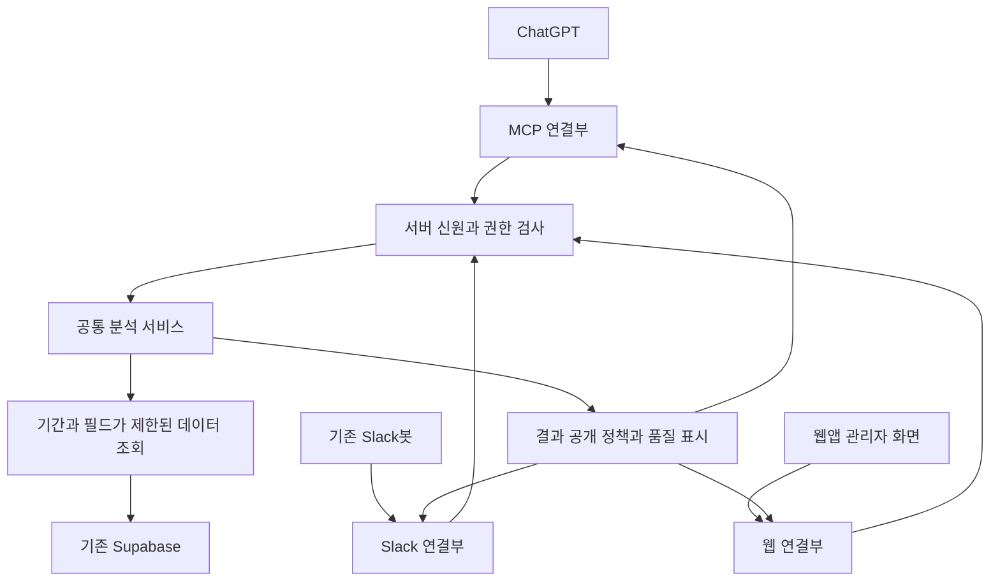

# 센터 통합 분석과 ChatGPT 연결 최종 설계

이 설계의 구현 대상은 **기존 관리자 계정으로 연결하는 ChatGPT 앱과, ChatGPT·Slack·웹앱이 공유하는 센터 분석 기능**이다. 기존 Supabase와 Firebase Hosting에서 시작한다. ChatGPT 연결 서버는 데이터 조회와 계산만 수행하며 OpenAI API를 호출하지 않는다. Slack봇의 기존 AI 호출은 별도로 유지한다.

설계 기준일은 2026년 10월 7일이다. 기준 커밋은 `a5315dabb5636875380037c9f2e83ca4a8fb04a7`이며, 작업 트리에는 미커밋 변경이 많다. 이 작업은 로컬 구현과 검증까지 포함하며, 실제 운영 활성화 여부는 [validation.md](./validation.md)에서 별도로 구분한다. 코드 존재·문서의 과거 운영 기록·현재 운영 상태를 구분해야 한다.

## 문서 읽는 순서

1. 이 문서: 확정한 구조와 범위.
2. [SPEC.md](./SPEC.md): 인증, DB 권한, 도구, 지표, 오류, 성능 계약.
3. [IMPLEMENTATION.md](./IMPLEMENTATION.md): 구현 순서, 파일별 작업, 수용 검사, 배포와 인수인계 프롬프트.

세 문서는 하나의 구현 명세다. 과거 MCP 초안과 충돌할 경우 **이번 통합 기능의 목표 설계**에는 이 명세를 적용한다. 기존 기능이나 운영 설정을 일괄 삭제·교체할 권한을 뜻하지 않는다. 사용자 지시와 저장소 `AGENTS.md`가 우선한다.

## 확정 결정

| 항목 | 결정 |
| --- | --- |
| 계정 | 센터의 기존 관리자 계정. 별도 분석 서비스 계정 가입 없음 |
| 관리자 정의 | 보호된 `account_security.account_roles`의 활성 `admin` 또는 `master` |
| 초기 이용자 | 검증된 운영자 한 명을 명시적으로 등록. 이름·이메일·첫 master 조회로 추정하지 않음 |
| 인증 제공자 | 기존 Supabase OAuth 2.1. 토큰 발급·코드 교환·PKCE·갱신은 Supabase 담당 |
| 접근 허용 | 관리자 신원 + 명시적인 연결 권한 + 현재 계정 상태를 매 요청 확인 |
| ChatGPT 연결 | 공식 MCP SDK의 Streamable HTTP. 자체 JSON-RPC 구현을 새로 작성하지 않음 |
| 분석 실행 | 공통 서버 모듈에서 검증된 질의와 결정적 계산 수행 |
| AI 역할 | 질문 해석, 분석 도구 선택, 결과 설명과 문안 작성 |
| 운영 저장 | 첫 릴리스는 분석과 초안 작성. 실제 기록 변경 도구는 후속 단계 |
| 데이터 경계 | 식별자를 이용한 연결은 서버 내부. 외부 도구 결과에는 개인별 행·고정 가명·해시 목록 없음 |
| 데이터 접근 | 전용 DB 접속 역할과 내부 사실 뷰. ChatGPT 토큰은 DB 접근에 사용하지 않음 |
| 운영 기반 | 기존 Supabase 프로젝트 + 기존 Firebase Hosting. 별도 Auth0·AI 서버·분석 DB 도입 없음 |
| 코드 재사용 | 필수 조건 아님. 지표·권한·수용 계약에 맞는 순수 계산과 검증 코드는 재사용 가능 |
| 비용 | ChatGPT 분석 경로에 API 모델 호출 추가 없음. 기존 서비스의 사용량·플랜 한도는 적용됨 |

Supabase OAuth가 실제 환경에서 이 명세의 토큰 격리와 철회를 충족하는지 먼저 확인한다. 검증 실패는 구현상 해결해야 할 차단 조건이며, 일반 관리자 토큰 전달·무인증·광범위 service key로 대체하지 않는다. 인증 제공자를 임의로 변경하지 않는다.

## 전체 구조

그림의 각 상자는 논리적 책임이다. 각각의 서버나 유료 서비스를 만들지 않는다. ChatGPT와 웹용 경로는 새 Edge Function `center-api` 하나에 둔다. 기존 Slack 함수는 공통 서버 모듈을 import한다. 채널 간 내부 HTTP를 늘리지 않는다.

공통 모듈은 HTTP·MCP·Slack 형식을 모른다. 인증 연결부가 생성한 `ActorContext`, 검증된 분석 요청, 데이터 저장소 인터페이스를 받는다. 채널별 권한과 공개 범위는 결과 생성 전에 적용된다. 같은 권한·입력·기준시점·지표 버전이면 같은 수치가 나와야 한다.

## 첫 릴리스 범위

첫 릴리스는 단순 합계 조회만으로 완료 처리하지 않는다. 다음 분석을 함께 제공한다.

| 사용자 질문 | 제공할 분석 | 한계 표시 |
| --- | --- | --- |
| 이번 달과 지난달 운영이 어떻게 달라졌나 | 방문 세션·순방문자·방문일·체류·신청·기록상 출석의 같은 정의 비교 | 진행 중인 기간, 누락 퇴실, 현재 상태 기반 신청 표시 |
| 프로그램에 참여한 사람들이 다시 오는가 | 프로그램 참여 집단의 7·14·30일 센터 재방문 | 관찰 완료자와 관찰 중인 사람 분리 |
| 참여 전후 센터 이용이 어떻게 달라졌나 | 같은 사람의 전후 방문일수·세션·실측 체류 비교 | 전후 기간 부족, 실측 누락, 인과효과 아님 표시 |
| 여러 프로그램을 이용하는가 | 서로 다른 프로그램 수의 분포, 기록상 재참여와 프로그램 간 이동 | 같은 날 순서 불명확, 현재 출석 상태 한계 표시 |
| 신청·출석·만족도를 함께 비교해줘 | 프로그램별 현재 신청·기록상 출석·유효 만족도 표 | 만족도는 응답자 집단이며 참석자 전체를 대표한다고 단정하지 않음 |
| 대여·스토어·설문도 함께 보여줘 | 같은 기간의 영역별 집계 | 동일인 연결키가 검증되지 않은 영역은 기간 기준 병렬 비교만 제공 |
| 프로그램 안내문이나 운영 보고서를 작성해줘 | 승인된 프로그램 정보와 분석 결과를 ChatGPT가 문안으로 구성 | 공지·메시지를 자동 게시하지 않음 |

현재 자료로 불가능한 지표도 도구에서 명확한 이유와 함께 표시한다. 예를 들어 엄밀한 사전신청자 출석률을 위한 신청 출처·당시 상태가 없으면 계산하지 않는다. 기록 기반 분석까지 일괄 중단하지 않는다.

## 현재 저장소와의 관계

| 현재 위치 | 확인된 내용 | 구현 시 처리 |
| --- | --- | --- |
| `supabase/functions/slack-tsf/index.ts` | OpenAI API, Slack 인증, 자료 조회, 공지·Notion 초안/확인 기능이 한 함수에 있음 | 인증·응답 흐름 보존. 새 분석 경로부터 공통 서비스로 연결 |
| `supabase/functions/_shared/operationStatistics/` | 방문·참여 순수 계산과 공개 경계가 준비됨 | 합성 테스트와 의미를 확인하고 공통 모듈로 옮기거나 감싸기 |
| `supabase/functions/_shared/centerMcp/` | 자체 MCP 처리, JWT 검사, Auth 내부 상태 조회, 게시 결과 저장 초안 | 참고 자료. SDK 기반 연결부와 새 연결 권한 모델로 교체 대상 |
| `supabase/functions/_shared/centerMcp/liveStore.mjs` | 세션 생성과 OAuth 승인 시각의 차이로 동의 증명을 연결 | 시각 근접성으로 권한을 증명하는 방식을 채택하지 않음 |
| `supabase/functions/_shared/centerMcp/releaseStore.mjs` | 기간이 겹치는 새 통계 공개를 전부 차단 | 통합 분석에 맞는 명시적 공개 정책·감사·권한별 캐시로 대체. 기존 기록 삭제 금지 |
| `src/pages/OAuthConsent.jsx` | 기존 로그인 UI와 동의 경로 초안 | UI 골격 재사용 가능. 하드코딩된 client/callback과 동의 상태 처리 수정 |
| `accountAuthorization.mjs`, `sessionContinuity.mjs` | 보호된 계정 매핑·역할·credential version·검증 로그인 확인 | 웹 동의/관리 경로의 신원 근거로 사용 |
| `sessionReadStore.mjs` | 현재 `loadLiveSession`이 DB 조회 없이 `live:true` 반환 | 실제 세션 철회 증거로 간주 금지. 새 연결 경로의 실제 live 검사 추가 |
| `src/utils/visitUtils.js`, `analyticsUtils.js` | 기존 화면 계산 | 지표 이름별 차이를 비교하고 버전 전환. 수치를 조용히 바꾸지 않음 |
| `src/api/feedbackApi.js`, `src/utils/programFeedbackModel.js` | 구형/신형 설문과 만족도 해석 | 익명 숫자 추출만 서버로 이식. `select('*')`나 사용자 상세 조인은 재사용하지 않음 |
| `docs/center-mcp-activation.md` | 과거 운영 준비 설정과 미완료 기록 | 실제 관리 화면·메타데이터로 재확인. 이 문서만으로 운영 완료 판정 금지 |
| `supabase/migrations/20261006010000_center_mcp_readonly.sql` | 검토 초안 표시가 있으나 자동 migration 폴더에 존재 | 적용 이력과 의존성 확인 전 `db push` 금지. 적용됐다면 수정 대신 후속 migration |

기존 Slack 프로그램 조회 코드에는 응답자 이름과 자유서술 피드백을 구성하는 경로도 있다. 새 ChatGPT 분석 도구에 해당 출력을 그대로 연결하지 않는다. 구형 문서의 “집계만 제공” 설명을 실제 코드보다 우선하지 않는다.

## 최소 구현과 향후 확장

지금 구현할 것은 하나의 공통 분석 서비스, MCP/웹 연결부, Slack 연결, OAuth 동의 화면, 최소 권한 저장소다. **웹앱 관리자 설정 메뉴에는 ChatGPT 연결 항목을 추가하지 않는다.** 지표 정의와 오류 계약을 먼저 고정한다.

장기간 분석이 실제 성능 기준을 넘을 때 비동기 작업자를 추가한다. 읽기 전용 복제 DB·별도 분석 저장소·벡터 DB·외부 AI 호출은 첫 릴리스에 넣지 않는다. 현재 조회량으로 분리가 필요한지 측정한 후 결정한다.

운영 쓰기는 분석과 별도 capability로 추가한다. 공지 초안 저장을 첫 후보로 하고 웹에서 승인하도록 한다. 회원·포인트·출입 원본의 일괄 변경 기능은 이 계획의 첫 구현 범위에 없다.

## 사용자 경험

1. ChatGPT에서 센터 앱을 연결한다.
2. 기존 센터 로그인 화면에서 관리자 계정으로 로그인한다.
3. 센터가 제공할 데이터·분석 범위와 수정 권한 없음이 표시된다.
4. 승인하면 ChatGPT로 돌아간다.
5. 질문에 따라 분석 결과, 기준 기간, 분모, 갱신 시각, 제한 사항을 함께 받는다.
6. 웹앱 관리자 설정에는 이 연결을 위한 새 메뉴가 나타나지 않는다. 연결 해제의 실제 클라이언트 흐름은 native OAuth 제공자와 ChatGPT 연결 화면에서 P0 검증 후 확정한다.

초기 허용 운영자 지정은 설치 담당자가 검증된 계정 식별자를 등록하는 절차다. 운영자가 UUID를 채팅에 붙여 넣어야만 사용할 수 있는 제품 흐름을 만들지 않는다.

## 공식 근거

- [OpenAI MCP 서버 구현](https://developers.openai.com/plugins/build/mcp-server): 표준 SDK, 도구 계약, 서버의 매 요청 권한 검사.
- [OpenAI OAuth 인증](https://developers.openai.com/plugins/build/auth): OAuth discovery와 resource 대상 토큰 검증.
- [Supabase OAuth 시작](https://supabase.com/docs/guides/auth/oauth-server/getting-started): 기존 프로젝트의 OAuth 기능과 동의 UI.
- [Supabase OAuth 토큰 보안](https://supabase.com/docs/guides/auth/oauth-server/token-security): 기본 OAuth 토큰과 OIDC scope가 DB 권한 제한을 대신하지 않는다는 점.
- [Supabase Token Hook](https://supabase.com/docs/guides/auth/auth-hooks/custom-access-token-hook): client별 발급 claims 처리 시 필수 claims 보존.
- [Supabase OAuth grant 관리](https://supabase.com/docs/guides/auth/oauth-server/oauth-flows): 사용자 grant 확인·철회.
- [Supabase DB 역할](https://supabase.com/docs/guides/database/postgres/roles): 서비스별 최소 권한 DB 계정.
- [Supabase Edge 실행 제한](https://supabase.com/docs/guides/functions/limits): CPU·메모리·시간 한도를 고려한 분석 실행.

문서가 지원 사실을 설명하더라도 해당 프로젝트의 실제 SDK 버전·Hook·RLS·OAuth 세션 동작은 별도 수용 검사를 통과해야 한다. 자세한 검사와 작업 단위는 [구현 계획](./IMPLEMENTATION.md)에 정의한다.
